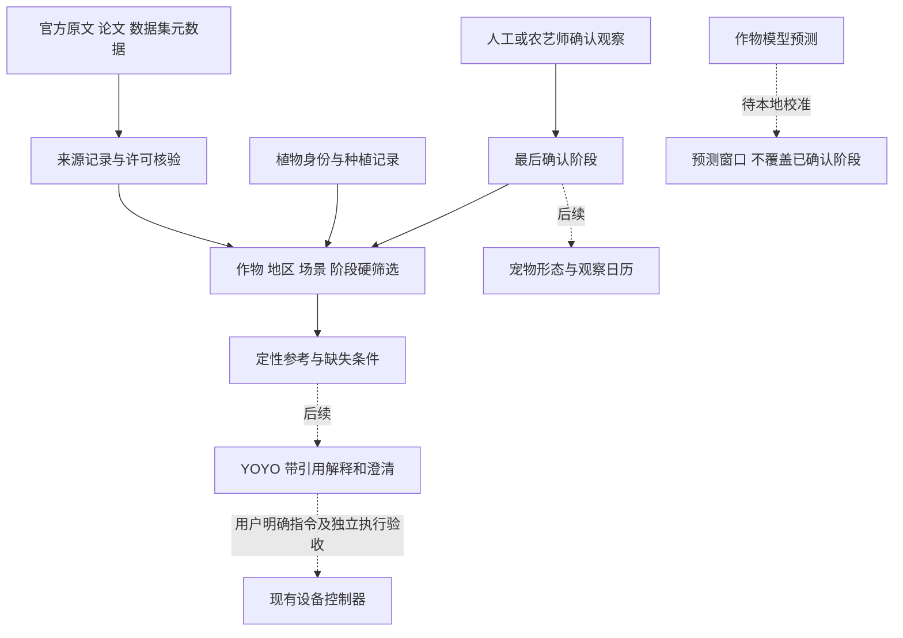

# 作物知识库与地区化种植方案

RoboPlanter 的真实养护方案应从“这是什么植物、种在哪里、现在长到哪一步”开始。知识库不能只保存问答文本，还要保存每条知识的出处、适用条件和版本。宠物的形态跟随已确认的植物观察；互动积分只用于陪伴反馈。具体设计见 [植物生长与陪伴养成](/docs/projects/2026/roboplanter/plant-companion)。

来源目录包含 **33 条来源记录**，覆盖官方农技、大学推广、研究论文、模型、词表和数据集，并提供 [可运行的离线知识原型](/roboplanter/source/integrations/crop-knowledge/README.md.txt)。它包含 4 张美国州级定性参考示例卡，用来验证筛选逻辑；不是已经建成全国全作物处方库，也没有接通 YOYO 或自动水肥控制。

## 先确定真实植物的档案

每株或每批植物需要一个独立身份，至少记录：

- **作物**：中文名、拉丁学名、品种；不能只填“多肉”或根据精灵头像推定物种。
- **地区**：国家、省级行政区、城市；生产季节、海拔及局部小气候在需要时补充。原型省级字段使用 ISO 3166-2 编码。
- **场景**：室内工位、阳台、温室或露地。室外天气不能直接当空调房或温室内测量。
- **起点**：播种、移栽、购入成株等真实事件及日期。不知道苗龄时，不能从购入日期重新算成一颗种子。
- **目标与条件**：采叶、观花、结果或繁殖；生长型、砧木/接穗、株龄、盆容积、基质、排水、水质、光照和已有管理记录按需求补全。
- **当前观察**：日期、观察者、部位和现象，例如展开真叶、出现花蕾、开放花、幼果、成熟果或休眠。照片模型的判断先作为待确认建议。

地区、作物、品种和种植场景未确定前，不生成专属成熟日历、施肥配方或农药剂量。番茄案例用于说明条件筛选。

## 哪些来源各自负责什么

### 农技原文负责有条件的操作知识

[2025 年南方春季蔬菜生产管理技术指导意见](https://nynct.fujian.gov.cn/ztzl/fzjz/kzjs/202503/t20250317_6780040.htm)由福建省农业农村厅转载农业农村部资料，按南方地区、生产方式和作物类群讨论育苗、通风、水肥、整枝和防虫。它适合提取带条件的知识，不能去掉“春季、南方、大棚/露地”等限定后当通用规则。

[湖北 2026 年春季果园管理技术](https://nyt.hubei.gov.cn/bmdt/yw/ywtz/sgcbgs_9007/202603/t20260302_5883302.shtml)覆盖柑橘、桃、梨、葡萄，包含不同物候和树龄下的管理以及梨的辅助授粉。这能支撑“授粉任务需按作物及花期筛选”，不能直接变成室内香草的任务。

[湖南 2023—2025 年主要农作物科学施肥指导意见](https://agri.hunan.gov.cn/agri/xxgk/tzgg/202304/t20230427_29325373.html)展示了分区、作物、树龄和阶段如何影响施肥。指导期已结束，2026 年应作为历史参考并继续查当地当季资料，不能冒充当前默认处方。

[DB3201/T 1246—2025 茄子嫁接育苗技术规程](https://amr.nanjing.gov.cn/ztzl/bzhzl/tzgg/202503/P020250314425471809716.pdf)提供南京地区茄子育苗的条件和流程。嫁接时机与砧木、接穗发育有关；它不是所有果树和盆栽的通用教材。实际应用前还须复核标准状态。

### 国家农业科学数据中心负责具体数据集

国家农业科学数据中心收录了以下阶段识别相关数据：

- [辽宁绥中富士苹果散粉状态图集 ABP51](https://www.agridata.cn/data.html#/datadetail?id=292606)，数据 DOI [10.57760/sciencedb.j00001.01013](https://doi.org/10.57760/sciencedb.j00001.01013)。页面记录 2460 张基础图像与 8490 张增强图像，能作为特定花期识别的研究输入。
- [不同成熟度番茄果实多模态图像数据集](https://www.agridata.cn/data.html#/datadetail?id=292604)，数据 DOI [10.57760/sciencedb.j00001.00946](https://doi.org/10.57760/sciencedb.j00001.00946)。来自安徽六安，页面记录 4000 组 RGB、深度、近红外数据及未熟/半熟/成熟标签。

两页均声明 **CC BY 4.0**，同时标明“协议共享”；获取流程、引用和具体制品仍需逐项核对。增强图像不是新的独立植株，4000 组图像也不是 4000 株的长期生长试验。

这些数据可以帮助研究“看到了什么阶段”，不包含完整水肥干预和产量因果关系。模型在这些数据上表现好，也不能直接推出它适合用户手机、当地品种或不同光照。上线前需独立采集本地测试集，检查识别错误并保留人工确认。

### 论文和物候体系负责模型与定义

[BBCH 专著，Meier 主编，2018](https://doi.org/10.5073/20180906-074619)提供物候阶段语言；[积温方法研究，McMaster 与 Wilhelm，1997](https://digitalcommons.unl.edu/usdaarsfacpub/83/)说明计算法不能含糊；[FAO56，Allen 等，1998](https://www.fao.org/4/x0490e/x0490e00.htm)提供参考蒸散与作物系数框架。FAO56 [第 6 章](https://www.fao.org/4/x0490e/x0490e0b.htm)明确阶段长度会随区域、气候、栽培条件和品种变化，鼓励使用当地观察。

这些不是精确到每个花盆的参数表。积温需要适用的基温、算法、起算事件和完整温度数据；作物蒸散需要相应气象、作物及场景信息。土壤 ADC 相对百分比、室温和 WS2812 灯带亮度不足以直接给出精确灌水毫升数。

[Wisconsin 番茄指南](https://hort.extension.wisc.edu/files/2020/11/A1691.pdf)、[Cornell 整枝说明](https://cals.cornell.edu/school-integrative-plant-science/school-sections/horticulture-section/outreach-and-extension/pandemic-vegetable-gardening/pandemic-vegetable-gardening-2020-archive/training-tomatoes)和 [Maryland 高隧道授粉说明](https://extension.umd.edu/resource/problems-pollination-high-tunnel-tomatoes)适合演示如何保留生长型、环境和管理目的。这些是美国地区参考，不把播种日历、操作时刻或剂量原样搬到中国。

### 开源系统负责记录或计算

推荐分工如下，具体版本与权利说明保存在 [来源目录](/roboplanter/source/integrations/crop-knowledge/sources.json.txt)：

- **[farmOS](https://farmos.org/development/api/)**：借鉴植株/地块资产、种植批次和时间化农事日志，或对已有 farmOS 实例做后续适配。它是记录系统，不是现成的种植处方库。代码与文档许可分别核验。
- **[PCSE/WOFOST](https://github.com/ajwdewit/pcse)**：有匹配作物参数、土壤、天气及当地验证数据后，用于离线生长预测和对照。PCSE 代码使用 EUPL-1.2；参数文件的 Rights 和模型分支另查。不是拿到包就能准确预测工位薄荷。
- **[KU Leuven AquaCrop Fortran](https://github.com/KUL-RSDA/AquaCrop)**：其 Fortran 7.3 [LICENSE](https://github.com/KUL-RSDA/AquaCrop/blob/main/LICENSE)明确为 BSD-3，可作为权利较清楚的水分生产力模型候选，仍须核对输入数据并校准。
- **[FAO 官方 AquaCrop Python](https://github.com/un-fao/fao-AquaCrop)**：官方 7.3 方法和对照来源。当前 [LICENSE](https://github.com/un-fao/fao-AquaCrop/blob/main/LICENSE)保留权利并列出授权要求，不能因 README 的 open-source 描述就按 MIT/BSD 复制进项目。第三方 [AquaCrop-OSPy](https://github.com/aquacropos/aquacrop)也要独立核对版本、过程覆盖和制品许可。
- **[DSSAT-CSM](https://github.com/DSSAT/dssat-csm-os)**：适合专家参与的作物与管理情景试验，输入与维护成本更高；不作为首个工位版本的必需依赖。模型代码、参数和 Python 封装不是同一许可证。
- **[AGROVOC](https://www.fao.org/agrovoc/) 与 [Plant Ontology](https://github.com/Planteome/plant-ontology)**：用于同义词、身份与阶段术语索引，不会给出当地浇水方案。词表导入时记录具体 release、语言、许可和文件摘要。
- **[Open-Meteo](https://open-meteo.com/en/docs)**：提供室外气象背景，不能替代盆土或温室测量；数据许可与免费托管服务的使用条款分开处理。

[OpenFarm 官方仓库](https://github.com/openfarmcc/OpenFarm)已于 2025-04-22 归档，服务在 2025 年 4 月关闭。它可作为历史结构参考，不再作为新在线系统的依赖；代码 MIT 与数据库 CC0 也不代表所有众包内容均已通过本地农艺验证。

### 粮储和监管资源负责各自范围

[国家粮食和物资储备局标准入口](https://www.lswz.gov.cn/html/ywpd/bzzl/lybz.shtml)适合收获后的储藏、加工和检验，不能充当生长期水肥知识库。[国家标准全文公开系统](https://openstd.samr.gov.cn/bzgk/std/index)用于核对标准信息，不能把征求意见稿或历史版当现行标准。

涉及农药时，需要核对具体产品的当前登记、作物、防治对象、标签和当地要求。[农药数字监督管理平台](https://www.icama.cn/portal/homepage/index.do?id=h)是官方核验入口之一；知识库不生成未经核验的用药配方。

## 八类农事怎样形成知识条目

知识条目按以下条件组织：

| 类别 | 必须保留的适用条件 | 预期输出 |
| --- | --- | --- |
| 浇灌 | 作物/阶段、盆器或田块、基质/土壤、排水、已有水分、天气、供水能力 | 观察与决策依据；有本地标定才进一步算水量 |
| 施肥 | 作物/品种、阶段、土壤/基质、检测、水质、肥料成分、目标与已有投入 | 带来源的复核事项；不照搬田间每亩用量到盆栽 |
| 修剪 | 生长型、株龄、部位、季节、开花习性和目的 | 是否需要、适用部位与人工操作条件 |
| 日常打理 | 支撑、通风、老病叶、清洁与卫生条件 | 可观察、可记录的任务，区别普通养护与病害处置 |
| 授粉 | 作物繁殖特性、品种、花状态、环境与授粉方式 | 先确认是否需要，再查相应条件；不保证坐果 |
| 嫁接 | 砧木/接穗、相容性、苗体状态、技术与愈合环境 | 有条件的专业流程和记录，不作为游戏必做关卡 |
| 病虫管理 | 症状/虫种、发生部位、监测、阈值、物理/生物措施及登记要求 | 先观察识别与复核；识别不确定时不派发施药指令 |
| 采收/结果 | 采叶/观花/食用果等目标、成熟判据、品种与此前管理 | 记录实际采收或果实状态；不把模拟产量当实收 |

每张正式知识卡还需保存出处段落/页码、发表或生效日期、有效时间段、地区与场景、审核者、版本、证据类型、禁忌和未解决条件。来源冲突时并列给出条件差异，不能让语言模型挑一句最顺口的话覆盖其他证据。

当前 4 张示例卡只有上述字段的一部分，用来验证软件筛选；季节有效性、土壤检测、管理投入与审批尚未进入完整规则引擎，因此即使卡匹配成功也只显示为参考阅读。

## 从来源到 YOYO 的接入结构

离线原型实现来源检查、条件筛选和已确认阶段提取；虚线为后续接口。模型估算、检索摘要和知识卡匹配都不构成设备动作授权；现有设备身份、凭据、去重和本地截止保护继续独立生效。

## 离线原型怎么检查

下载最新 [源码包](https://peterpanstechland.github.io/roboplanter/downloads/roboplanter-starter.zip) 后，在项目根目录使用 Python 3。具体命令及合成样例见 [原型 README](/roboplanter/source/integrations/crop-knowledge/README.md.txt)。

原型只读取本地文件，没有网络抓取、向量数据库或硬件连接。它会列出缺失字段、排除不匹配参考、保留未知阶段；不会用预测记录或互动积分升级植物，不输出灌溉剂量和药肥处方。

要把它升级成实际知识服务，下一步是确认首批地区与精确作物，按目标环境逐条审核内容，补充完整规则与真实观察数据。只有现场验证了模型、传感器与执行器，才讨论受限自动控制。

## 数据质量与本地适配

资料使用前需要核对适用条件。每条资料保存出版机构、链接、版本、读取范围及许可；每个模型保存参数来源、算法与数据哈希；每次建议保存匹配了哪些条件、用了哪些证据、还有哪些未知。

本地试种应记录实际阶段日期、照片和误判，比较预测窗口与人工记录的偏差。水分方案应记录基质干湿、输入与排出水量、传感器校准和故障；果实/授粉识别数据应划分独立植株或时间批次的训练与测试，避免增强图像跨集合造成泄漏。节水、增产或成活率必须有对应现场试验，不能由一次演示或文献标题推出。

这份来源目录不是第三方全文语料镜像。未确认许可的内容只保留链接、书目与简要释义；明确许可的数据仍按具体数据集范围、引用和获取条款处理。
