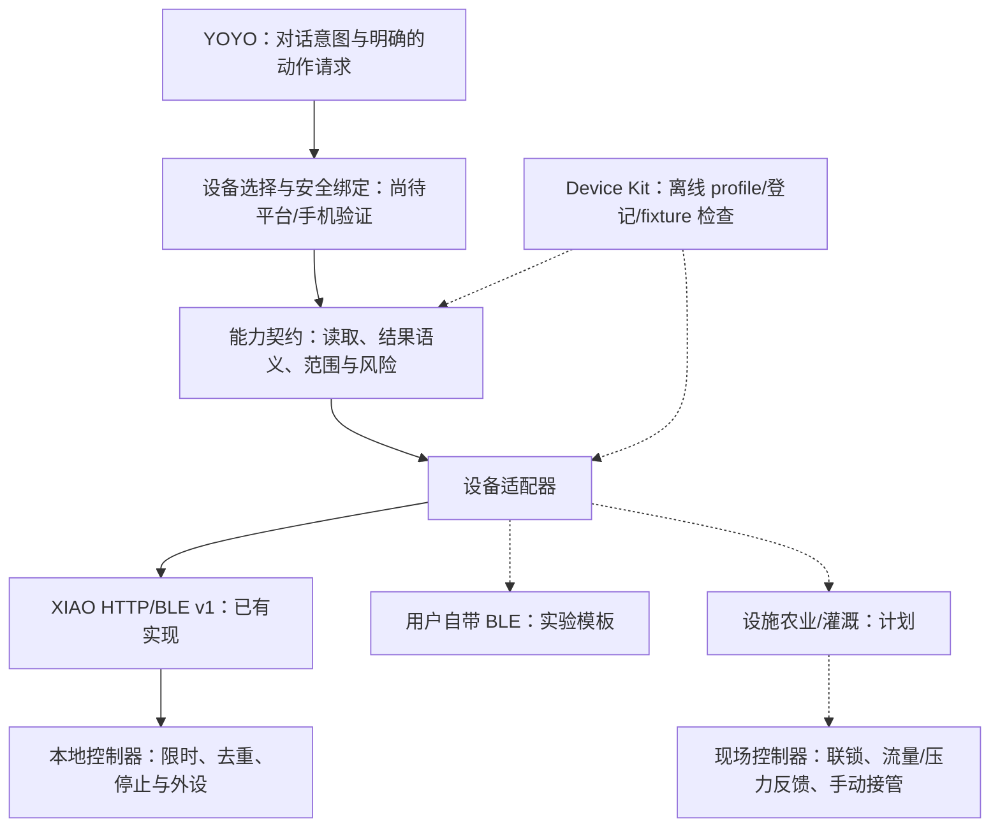

# 用户自带硬件的 RoboPlanter 设备平台

## 产品目标与当前交付

用户带来自己的硬件，选择或补充设备 profile，经适配和台架验证后从同一个 YOYO 入口使用。当前工位绿植是第一套设备实现；以后设施农业和灌溉需要新的设备能力、驱动与现场约束，不应把第一套 XIAO 引脚和水泵协议当成所有硬件的统一底层。

本次加入的是一个**可运行的离线接入基础层**：[Device Kit](/roboplanter/source/integrations/device-kit/README.md.txt)。它提供 profile 校验、设备登记、样例遥测解释、清单退役和测试，不提供在线设备管理服务。现有 XIAO 固件、Indicator、本地 MCP、云查询和 YOYO Skill 的协议与权限保持原有行为。当前没有通用多设备 YOYO 调度、自动配对、用户账号绑定、远程灌溉或后台定时任务。

这里区分四件事：设备型号描述、用户自己的设备实例、适配器代码、实际运行权限。写一个 JSON 描述不会产生驱动；登记一个设备不会证明拥有它；模拟数据通过不会证明真机在线；YOYO 能读懂能力名称不会自动获得硬件调用权限。

## 从小智借鉴什么

2026-10-25 阅读了 `78/xiaozhi-esp32` 的官方仓库。它把板级初始化与引脚配置放在独立板型目录，用独立型号和构建变体维护不同硬件；文档特别指出复用错误的型号身份可能导致 OTA 覆盖错误固件。这适合作为本项目“型号身份、适配模块和升级兼容性分开管理”的参考。[小智自定义板型指南](https://github.com/78/xiaozhi-esp32/blob/main/docs/custom-board.md)

小智的 OTA 代码另外处理设备标识、激活码或挑战，以及服务配置。这里借鉴“发现/登记、校验、绑定、启用、退役”的阶段分离，不复制其激活协议，也不把离线登记伪装成安全绑定。[小智 OTA/激活实现](https://github.com/78/xiaozhi-esp32/blob/main/main/ota.cc)

小智 README 明确包含唤醒、音频、ASR/LLM/TTS、WebSocket/MQTT 等能力，固件默认连接其服务。RoboPlanter 的语音和智能体入口已经选定 YOYO，因此不搬这些语音或云服务链路，不要求用户部署一套小智后端。[小智官方 README](https://github.com/78/xiaozhi-esp32/blob/main/README.md)

以上是架构参考，不代表两个项目协议兼容；本目录没有复制小智源码。

## 分层结构



图中的虚线代表尚未实现的路径或离线描述关系。Device Kit 不在真实命令通道中，图不能作为 YOYO 已打通多设备的证据。

### 1. 入口与设备选择

YOYO 继续负责对话。目标用户体验是先选定自己的设备，再查询或执行一次明确的动作。设备不明确时不能依赖“最近上线”或广播名称相似来选择泵。未来必须保存用户到设备的绑定关系，并让响应包含具体设备和请求编号；目前这些能力没有实现。

现有独立 Skill 的硬件门禁仍关闭。安全注入令牌、实际广播身份、MTU/长写、WRITE 确认、NOTIFY 业务回包都完成验证后，才能在后续版本调整 Skill。`profile.assistant` 固定为 `entrypoint=yoyo`、`binding_status=not_verified`、`execution_enabled=false`，校验器不接受把它们改成已绑定或可执行。

### 2. Profile：描述一种硬件

[JSON Schema](/roboplanter/source/integrations/device-kit/profile.schema.json.txt) 固定字段；[CLI](/roboplanter/source/integrations/device-kit/device_kit.py.txt) 额外验证引用、能力、范围及实现状态。

- `profile_id`：有版本语义的型号契约，例如 `xiao-roboplanter-v1`，不是某个用户的设备编号。
- `adapter`：协议版本、实现路径、是否已有运行时实现，以及样例遥测格式。`source_paths` 只作代码索引；CLI 不导入或执行其中的文件。
- `transports`：HTTP、BLE、MQTT 或 Modbus 的描述。协议类型可描述不等于已有驱动。HTTP origin 不得包含用户密码、查询参数或业务路径；BLE UUID 可在实验模板中留空。
- `credential_ref`：仅允许 `env:ROBOPLANTER_TOKEN` 或 `provisioning:device-credential` 这样的引用。Device Kit 不解析、不读取、不打印秘密值。它会拒绝 `token`、`password` 等额外字段；自由描述仍需人工避免填写秘密，校验器不是秘密扫描器。
- `capabilities`：能力 ID、读写性、单位、风险、状态、值/有效性/标定字段路径、范围、约束与传输映射。
- `interlocks`：接入时必须实现或核对的约束清单，不是传感器和联锁已经存在的证明。写能力必须声明风险及约束；水动作必须声明本地最大时长。
- `mappings`：现有协议到能力的**说明文本**。CLI 不做模板替换，不会把 `write` 文本发送出去。

`supported` 的含义是仓库已有对应本地协议实现，不能推出某块实物已验收；`experimental` 是模板或链路未完成验证；`planned` 是未来设计。三个状态在 CLI 中都有显式输出。

### 3. 设备实例：描述用户自己的那一台

登记簿中 `device_id` 是用户给自己的设备的稳定本地 ID，例如 `desk-01`；`hardware_id` 是设备真正报告的身份，例如 `RoboPlanter-ABCD`，默认与本地 ID 相同。`label` 是易读名称。名称和广播名都不是身份认证。

每条记录绑定 `profile_id`、profile 内容的 SHA-256 和选定 `transport_id`。同一 `device_id` 禁止覆盖；登记后的 profile 内容变化会使新的检查记录被拒绝，防止默默把一台设备换成另一套动作协议。正式变更应新建有明确版本的 profile，保留旧记录并迁移到新登记。

登记簿采用单文件原子替换，适合个人开发和一次一个进程写入。它没有多用户权限、并发写锁、同步、账户恢复或密钥生命周期管理。不要把它作为生产设备控制数据库。

### 4. 适配器与设备本地控制

现有 XIAO 的真正适配器在 [本地 HTTP bridge](/roboplanter/source/integrations/mcp/bridge.py.txt) 和固件中。Device Kit 只将其协议描述为能力；不会替代该 bridge，也不会把一个新 profile 自动接入六个 MCP 工具。

读取结果仍须带采样年龄、`valid` 与标定状态。空气湿度不能代替土壤湿度；空气/UV 的 ADC 原值不能改名为 CO₂、照度或 PAR。原协议的 `accepted` 表示受理，`completed` 是软件完成；没有流量、光照或出纸反馈时不能报告物理效果。

未知动作结果只查询原请求 ID，不能自动换 ID 重放。设备重启会清空当前 v1 去重记录。泵的限时与断连后的停止必须由设备本地执行，不能等云端或手机下一次消息。这些现有约束见 [设备协议](/roboplanter/source/docs/device-protocol.md.txt) 和 [本地 MCP 说明](/roboplanter/source/integrations/mcp/README.md.txt)。

## 三套样例的范围

**XIAO RoboPlanter v1 — supported**

[profile](/roboplanter/source/integrations/device-kit/profiles/xiao-roboplanter-v1.json.txt) 和 [fixture](/roboplanter/source/integrations/device-kit/fixtures/xiao-state.json.txt) 覆盖土壤相对湿度、环境温湿度、空气/UV 原始 ADC，以及浇水、停泵、灯、ASCII 小票的映射。HTTP 契约已有实现；BLE 仍标实验。HTTP 字段直接使用当前 `schema_version=1`：例如 `soil.percent`、`soil.valid`、`soil.calibrated`。动作映射仍是 `/api/v1/command`，结果查询仍是 `/api/v1/result`；没有改固件格式。

**通用 BLE 传感器 — experimental**

[profile](/roboplanter/source/integrations/device-kit/profiles/generic-ble-template-v1.json.txt) 和 [fixture](/roboplanter/source/integrations/device-kit/fixtures/generic-ble-state.json.txt) 是温度传感器的接入起点。UUID、厂商字节布局和配对条件未填写；没有 BLE 驱动。扩展者要把厂商返回值转成 `readings.air_temperature.value/valid`，确定单位、无效值与采样时间，才能建立实际适配器。样例通过只说明这一种标准化数据形状可解释。

**灌溉分区 — planned**

[profile](/roboplanter/source/integrations/device-kit/profiles/irrigation-zone-planned-v1.json.txt) 和 [fixture](/roboplanter/source/integrations/device-kit/fixtures/irrigation-state.json.txt) 描述土壤测量与一个有时间上限的分区动作，并列出干转、流量、压力、现场停止等将来的要求。Modbus 只是候选传输描述，没有寄存器定义、驱动或现场验收，不是可以直接接电磁阀运行的方案。

设施农业扩展前还需要按真实装置确定分区拓扑、阀门默认状态、掉电/断网行为、泵阀顺序、传感器校准、异常停机和人工接管。先以单分区、明确时长、现场可停止的台架验证积累证据，再评估批量操作、排程与自动化。当前不实现这些控制。

## 五分钟离线上手

以下在仓库根目录执行，Python 3.10+ 即可，文件只写 `/tmp`。与现有 MCP 的依赖环境分开。

```bash
python3 integrations/device-kit/device_kit.py validate integrations/device-kit/profiles/*.json

python3 integrations/device-kit/device_kit.py register \
  --profile integrations/device-kit/profiles/xiao-roboplanter-v1.json \
  --registry /tmp/roboplanter-devices.json \
  --device-id desk-planter-01 --label '工位绿植' --transport local-http

python3 integrations/device-kit/device_kit.py mock-check \
  --profile integrations/device-kit/profiles/xiao-roboplanter-v1.json \
  --fixture integrations/device-kit/fixtures/xiao-state.json \
  --registry /tmp/roboplanter-devices.json --device-id desk-planter-01

python3 integrations/device-kit/device_kit.py list --registry /tmp/roboplanter-devices.json

# 退役只改本地记录，不撤销实物令牌，不删除云端资源。
python3 integrations/device-kit/device_kit.py retire \
  --registry /tmp/roboplanter-devices.json --device-id desk-planter-01
```

第一次登记输出 `registered_offline`；带登记簿的样例检查通过后变成 `offline_checked`。`mock-check` 始终输出 `scope=offline_fixture_only`、`hardware_verified=false`、`yoyo_bound=false`、`execution_enabled=false`。没有名为 `active` 或 `online` 的状态，也不会把本机校验时间当成设备采样时间。

不同物理身份可以这样登记：

```bash
python3 integrations/device-kit/device_kit.py register \
  --profile integrations/device-kit/profiles/xiao-roboplanter-v1.json \
  --registry /tmp/another-registry.json \
  --device-id desk-01 --hardware-id RoboPlanter-ABCD \
  --label '工位一号' --transport local-http
```

为该记录检查 fixture 时，其中的 `device_id` 必须确实是 `RoboPlanter-ABCD`。样例的 ID 不能当作真机证据；实际设备返回的身份仍需在台架检查中核对。

只验证通用 BLE 或灌溉样例，不登记也可以：

```bash
python3 integrations/device-kit/device_kit.py mock-check \
  --profile integrations/device-kit/profiles/generic-ble-template-v1.json \
  --fixture integrations/device-kit/fixtures/generic-ble-state.json

python3 integrations/device-kit/device_kit.py mock-check \
  --profile integrations/device-kit/profiles/irrigation-zone-planned-v1.json \
  --fixture integrations/device-kit/fixtures/irrigation-state.json
```

无效 JSON、重复键、NaN/Infinity、超限输入、未知字段、错误映射、非法范围、缺少动作约束、profile 漂移和设备身份不匹配均返回退出码 2。有效但未知、未标定或过期的读数可以通过结构校验，仍输出 `usable=false` 和具体原因，数值不会补成零。

## 接入自己的硬件

1. **描述真实硬件。** 从最近的模板复制新 profile，使用自己的 `profile_id`，先标 `experimental`。记录支持的测量、单位、动作上限、断电状态、供电与接线文档。不要先复制水泵动作再寻找对应硬件。
2. **建立适配器边界。** 确定厂商协议的读取、结果查询和受限动作。纯传感器可以只读；写能力必须有明确的硬件/本地软件约束。把协议版本与型号身份绑定，避免将一个型号的引脚或寄存器用于另一个型号。
3. **提供离线数据。** 用无秘密的 fixture 表达有效、无效、未标定、过期和错误情况。标准化字段保留原始采样语义，不在收到通知时把旧数据刷新为新采样。
4. **运行校验与测试。** 新 profile 至少必须通过 schema 和跨字段校验；新增字节解码器要有厂商已知报文测试，错误格式不能变成“动作完成”。本工具不动态加载用户脚本，因此新增真正运行时适配器需要显式代码接入与审查。
5. **台架验证单台硬件。** 在已授权的现场环境，先只读，再分别验证短动作、本地限时、停止、掉线、设备重启、重复请求和未知结果。把测试记录与硬件型号、固件版本、连接方式关联。这一步不属于 Device Kit 的模拟通过。
6. **验证 YOYO 绑定与目标选择。** 核实官方工具的实际参数、身份与凭据注入，不猜测变量名。证明一个用户只控制其指定设备；多台设备选择与解除绑定需要独立实现。本阶段完成前现有 Skill 门禁继续关闭。
7. **按实际证据提升支持状态。** 仅增加实现过、测试过的能力。传输变更和破坏性协议变更使用新版本；退役登记不等于撤销真实凭据，实物和平台凭据生命周期要分别处理。

登记 → 离线检查是本次已经实现的生命周期；台架验收 → 安全绑定 → 有限启用 → 撤销/退役是后续交付阶段，当前没有自动化实现。

## 验证与已知限制

```bash
python3 -m unittest discover -s tests -p test_device_kit.py -v
python3 -m unittest discover -s tests -p test_mcp_result_validation.py -v
```

测试覆盖三套 profile/fixture、封闭 schema、秘密字段拒绝、YOYO 门禁、传输引用、泵时间上限、空值/标定/新鲜度、登记去重、profile 哈希变化、逻辑/物理身份区分、CLI 登记到退役的完整路径。测试替换网络 socket 以保证离线样例不发起连接。

本次顺带修复了本地 MCP 对畸形 `status` 的处理：原实现遇到数组/对象会在集合判断中抛出 `TypeError`；现在保留 `unknown`，并验证重复调用不会再次 POST。回归测试用替身 `_request`，不连接真实泵。

标准库校验器只实现本 schema 用到的 JSON Schema 关键字，不是通用 JSON Schema 引擎；遇到不支持的关键字会拒绝。遥测检查当前只解释数值测量，不能验收设备停止、执行器反馈、布线、访问控制或平台绑定。profile 是开发输入，不是可信执行权限源。
